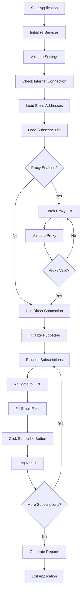
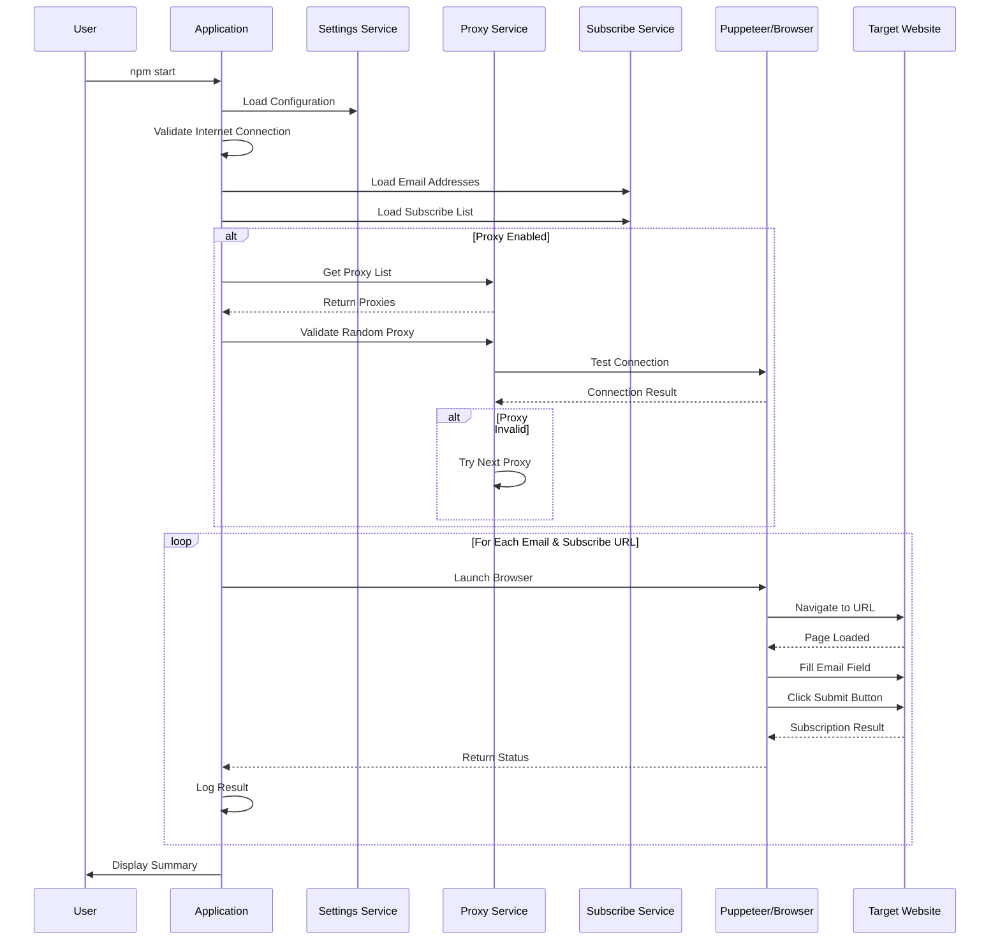

# Spam Revenge

A Node.js application that uses Puppeteer to automate subscribing email addresses to spam newsletters through random proxy servers. This tool can be used to "revenge spam" unwanted email addresses by submitting them to various spam services.

Built in March 2021. This automation tool connects to random proxy servers and subscribes target email addresses to spam newsletters using web scraping and form automation.

⚠️ **Ethical Notice**: This tool should be used responsibly and legally. Only use it on email addresses you own or have explicit permission to manage.

## Features

- 🔒 **Proxy Support**: Connects through random proxy servers for anonymity
- 🤖 **Automated Subscriptions**: Uses Puppeteer for form automation
- 📋 **Batch Processing**: Subscribe multiple email addresses in one run
- ✅ **Validation**: Validates proxies, URLs, and form fields
- 📊 **Status Tracking**: Tracks subscription success/failure with detailed statuses
- 🔍 **Logging**: Comprehensive logging of all operations
- 🛡️ **Stealth Mode**: Uses puppeteer-extra-plugin-stealth to avoid detection
- 🌍 **Country Filtering**: Filter proxies by country codes
- 🎲 **Random Selection**: Optionally randomize subscription order

## System Architecture



## Application Flow



## Getting Started

### Prerequisites

- Node.js (v14 or higher)
- npm or pnpm
- Internet connection
- Chrome/Chromium (installed automatically by Puppeteer)

### Installation

1. Clone the repository:
```bash
git clone https://github.com/orassayag/spam-revenge.git
cd spam-revenge
```

2. Install dependencies:
```bash
npm install
```

3. The postinstall script will automatically initialize the application

### Configuration

Edit the settings in `src/settings/settings.js`:

**Key Settings:**
```javascript
{
  // Email addresses to subscribe
  EMAIL_ADDRESSES: ['test@test.com'],
  
  // Production mode (true = real subscriptions)
  IS_PRODUCTION_ENVIRONMENT: false,
  
  // Use proxy connections
  IS_PROXY_CONNECTION_ACTIVE: true,
  
  // Maximum subscriptions per email
  MAXIMUM_SUBSCRIBES_COUNT: 2000,
  
  // Path to subscribe list JSON
  SUBSCRIBE_LIST_FILE_PATH: '../../sources/subscribe-list.json'
}
```

### Subscribe List Format

Create a `sources/subscribe-list.json` file:
```json
[
  {
    "urlAddress": "https://example.com/newsletter",
    "textBoxFieldName": "email",
    "textBoxFieldValue": "email",
    "buttonFieldName": "button",
    "buttonFieldValue": "Subscribe"
  }
]
```

## Available Scripts

### Main Application
Run the subscription process:
```bash
npm start
```

### Backup
Create a backup of the application:
```bash
npm run backup
```

### Sandbox Testing
Run sandbox tests:
```bash
npm run sand
```

### Stop Processes
Stop all Node.js processes (Windows):
```bash
npm run stop
```

## Project Structure

```
spam-revenge/
├── src/
│   ├── configurations/        # Configuration files
│   │   ├── ignoreEmailAddressesList.configuration.js
│   │   ├── ignoreSubscribeURLsList.configuration.js
│   │   └── countriesCodesList.configuration.js
│   ├── core/
│   │   ├── enums/            # Status enums and constants
│   │   └── models/           # Data models
│   ├── logics/               # Business logic
│   │   ├── subscribe.logic.js
│   │   └── backup.logic.js
│   ├── scripts/              # Entry point scripts
│   │   ├── subscribe.script.js
│   │   ├── backup.script.js
│   │   └── initiate.script.js
│   ├── services/             # Service layer
│   │   ├── application.service.js
│   │   ├── proxy.service.js
│   │   ├── puppeteer.service.js
│   │   ├── subscribeList.service.js
│   │   └── emailAddress.service.js
│   ├── settings/             # Application settings
│   │   └── settings.js
│   ├── tests/                # Test files
│   └── utils/                # Utility functions
├── sources/                  # Source files (subscribe list)
├── dist/                     # Generated output and logs
└── package.json
```

## How It Works

### 1. Initialization Phase
- Validates all settings
- Checks internet connection
- Loads email addresses
- Parses subscribe list JSON

### 2. Proxy Setup (if enabled)
- Fetches available proxy servers
- Validates proxy connection
- Checks anonymity level
- Verifies country code
- Tests connectivity

### 3. Subscription Process
- Launches Puppeteer browser (headless)
- Navigates to subscription URL
- Locates email input field
- Fills in email address
- Clicks subscribe button
- Logs result

### 4. Status Tracking
Each subscription is tracked with statuses:
- `CREATE`: Ready to process
- `SUBSCRIBE`: Successfully subscribed
- `FAIL`: Subscription failed
- `DUPLICATE`: URL already processed
- `INVALID_URL`: Malformed URL
- `IGNORE`: In ignore list

## Development

### Development Mode
Set `IS_PRODUCTION_ENVIRONMENT: false` in settings to:
- Simulate subscriptions without real HTTP requests
- Add delays to mimic real behavior
- Test configurations safely

### Production Mode
Set `IS_PRODUCTION_ENVIRONMENT: true` for:
- Real subscription submissions
- Actual proxy connections
- Live website interactions

### Adding New Subscribe URLs

1. Inspect the target website's newsletter form
2. Identify the email input field (name/id)
3. Identify the submit button (name/id/value)
4. Add entry to `subscribe-list.json`
5. Test in development mode first

## Error Codes

| Code | Description |
|------|-------------|
| 1000016 | No valid subscribes found |
| 1000017 | No subscribes after validation |
| 1000018 | No CREATE status subscribes |
| 1000019 | File path not found |
| 1000020 | Path is directory, not file |
| 1000021 | File must be JSON format |
| 1000022 | No data in JSON file |

## Dependencies

**Main Dependencies:**
- `puppeteer` - Headless Chrome automation
- `puppeteer-extra` - Plugin framework for Puppeteer
- `puppeteer-extra-plugin-stealth` - Avoid bot detection
- `proxy-lists` - Fetch proxy servers
- `fs-extra` - Enhanced file system operations
- `ip-regex` - IP address validation
- `is-reachable` - Check URL reachability
- `random-useragent` - Random user agent strings

**Dev Dependencies:**
- `eslint` - Code linting

## Ethical and Legal Considerations

⚠️ **Important Guidelines:**

1. **Only use on email addresses you own or control**
2. **Respect privacy laws** (GDPR, CAN-SPAM, etc.)
3. **Do not use for harassment or malicious purposes**
4. **Some jurisdictions may have specific laws about automated form submissions**
5. **Check terms of service of target websites**
6. **Use proxy connections responsibly**

This tool is provided for educational purposes and legitimate use cases only.

## Troubleshooting

### Common Issues

**Puppeteer Installation Issues:**
```bash
# Skip Chromium download during install
PUPPETEER_SKIP_DOWNLOAD=true npm install

# Then download Chromium manually
node node_modules/puppeteer/install.js
```

**Proxy Connection Failures:**
- Increase `MAXIMUM_PROXY_VALIDATIONS_RETRIES_COUNT`
- Check firewall settings
- Verify internet connection
- Try different proxy sources

**Form Selector Errors:**
- Inspect website HTML structure
- Verify field names match exactly
- Check for dynamic content loading
- Test selectors manually in browser console

## Contributing

Contributions are welcome! Please see [CONTRIBUTING.md](CONTRIBUTING.md) for guidelines.

## Author

* **Or Assayag** - *Initial work* - [orassayag](https://github.com/orassayag)
* Or Assayag <orassayag@gmail.com>
* GitHub: https://github.com/orassayag
* StackOverflow: https://stackoverflow.com/users/4442606/or-assayag?tab=profile
* LinkedIn: https://linkedin.com/in/orassayag

## License

This application is licensed under the MIT License - see the [LICENSE](LICENSE) file for details.

## Acknowledgments

- Built with [Puppeteer](https://pptr.dev/)
- Uses [proxy-lists](https://github.com/chill117/proxy-lists) for proxy fetching
- Stealth plugin from [puppeteer-extra](https://github.com/berstend/puppeteer-extra)
