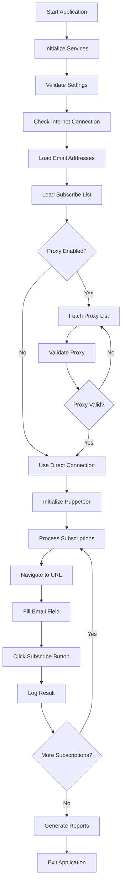
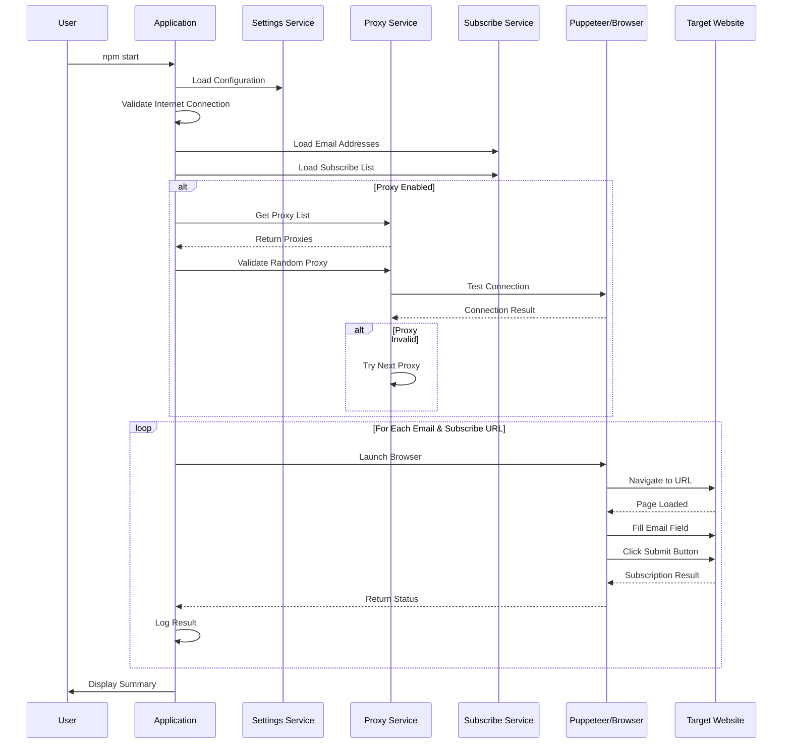

# Spam Revenge

A robust Node.js automation utility designed to seamlessly subscribe targeted email addresses to digital newsletter services using Puppeteer.

Built in March 2021, this application leverages automated web scraping and precise form interaction to process high-volume request batches. For maximum security, it routes all automation traffic through a rotating pool of random proxy servers while utilizing advanced stealth evasion plugins. This setup effectively bypasses modern bot detection mechanisms, ensuring reliable execution for security audits, legal compliance testing, or defensive counters.

## Features

- 🔒 **Proxy Support**: Connects through random proxy servers for anonymity
- 🤖 **Automated Subscriptions**: Uses Puppeteer for form automation
- 📋 **Batch Processing**: Subscribe multiple email addresses in one run
- ✅ **Validation**: Validates proxies, URLs, and form fields
- 📊 **Status Tracking**: Tracks subscription success/failure with detailed statuses
- 🔍 **Logging**: Comprehensive logging of all operations
- 🛡️ **Stealth Mode**: Uses puppeteer-extra-plugin-stealth to avoid detection
- 🌍 **Country Filtering**: Filter proxies by country codes
- 🎲 **Random Selection**: Optionally randomize subscription order

### Core Capabilities

- **Automated Newsletter Subscriptions**: Bulk subscribe email addresses to newsletter services
- **Proxy Rotation**: Random proxy server selection with validation
- **Stealth Evasion**: Advanced anti-bot detection bypass using puppeteer-extra-plugin-stealth
- **Batch Processing**: Efficiently process large lists of email addresses and subscription URLs
- **Status Tracking**: Detailed tracking of subscription outcomes

### Technical Excellence

- **Headless Browser Automation**: Leverages Puppeteer for reliable form interaction
- **Proxy Validation**: Comprehensive proxy health and anonymity checks
- **Stealth Plugins**: Advanced evasion techniques to avoid bot detection
- **File System Operations**: Enhanced file handling with fs-extra
- **Random User Agents**: Dynamic user agent rotation for anonymity

### Developer Experience

- **Simple Configuration**: Centralized settings file for easy customization
- **Sandbox Testing**: Safe testing environment without real subscriptions
- **Comprehensive Logging**: Detailed logs for debugging and monitoring
- **Backup System**: Automated application backup functionality
- **Clean Architecture**: Well-organized codebase with clear separation of concerns

## System Architecture



## Application Flow



## Getting Started

### Prerequisites

- Node.js (v14 or higher)
- npm or pnpm
- Internet connection
- Chrome/Chromium (installed automatically by Puppeteer)

### Installation

1. Clone the repository:

```bash
git clone https://github.com/orassayag/spam-revenge.git
cd spam-revenge
```

2. Install dependencies:

```bash
npm install
```

3. The postinstall script will automatically initialize the application

### Configuration

Edit the settings in `src/settings/settings.js`:

**Key Settings:**

```javascript
{
  // Email addresses to subscribe
  EMAIL_ADDRESSES: ['test@test.com'],

  // Production mode (true = real subscriptions)
  IS_PRODUCTION_ENVIRONMENT: false,

  // Use proxy connections
  IS_PROXY_CONNECTION_ACTIVE: true,

  // Maximum subscriptions per email
  MAXIMUM_SUBSCRIBES_COUNT: 2000,

  // Path to subscribe list JSON
  SUBSCRIBE_LIST_FILE_PATH: '../../sources/subscribe-list.json'
}
```

### Subscribe List Format

Create a `sources/subscribe-list.json` file:

```json
[
  {
    "urlAddress": "https://example.com/newsletter",
    "textBoxFieldName": "email",
    "textBoxFieldValue": "email",
    "buttonFieldName": "button",
    "buttonFieldValue": "Subscribe"
  }
]
```

## Usage

### Running the Application

To start the subscription process:

```bash
npm start
```

### Configuration Options

Edit `src/settings/settings.js` to customize:

- Email addresses to subscribe
- Production mode (real vs simulated subscriptions)
- Proxy connection settings
- Maximum subscription limits
- File paths

## Available Scripts

### Main Application

Run the subscription process:

```bash
npm start
```

### Backup

Create a backup of the application:

```bash
npm run backup
```

### Sandbox Testing

Run sandbox tests:

```bash
npm run sand
```

### Stop Processes

Stop all Node.js processes (Windows):

```bash
npm run stop
```

## Directory Structure

```
spam-revenge/
├── src/
│   ├── configurations/        # Configuration files (ignore lists, country codes)
│   │   ├── files/
│   │   │   ├── countriesCodesList.configuration.js
│   │   │   ├── ignoreEmailAddressesList.configuration.js
│   │   │   └── ignoreSubscribeURLsList.configuration.js
│   │   └── index.js
│   ├── core/
│   │   ├── enums/            # Status enums and constants
│   │   │   ├── files/
│   │   │   │   ├── placeholder.enum.js
│   │   │   │   ├── proxy.enum.js
│   │   │   │   ├── subscribe.enum.js
│   │   │   │   ├── system.enum.js
│   │   │   │   └── text.enum.js
│   │   │   ├── enum.utils.js
│   │   │   ├── index.js
│   │   │   └── text.utils.js
│   │   └── models/           # Data models
│   │       ├── files/
│   │       │   ├── ApplicationData.model.js
│   │       │   ├── BackupData.model.js
│   │       │   ├── BackupDirectory.model.js
│   │       │   ├── CountLimitData.model.js
│   │       │   ├── EmailAddressesData.model.js
│   │       │   ├── LocalData.model.js
│   │       │   ├── LogData.model.js
│   │       │   ├── PathData.model.js
│   │       │   ├── ProxyData.model.js
│   │       │   ├── ResponseData.model.js
│   │       │   ├── SubscribeData.model.js
│   │       │   └── SubscribesData.model.js
│   │       └── index.js
│   ├── scripts/              # Entry point scripts
│   │   ├── backup.script.js
│   │   ├── error.script.js
│   │   ├── initiate.script.js
│   │   └── subscribe.script.js
│   ├── services/             # Service layer
│   │   ├── files/
│   │   │   ├── application.service.js
│   │   │   ├── confirmation.service.js
│   │   │   ├── countLimit.service.js
│   │   │   ├── emailAddress.service.js
│   │   │   ├── initiate.service.js
│   │   │   ├── local.service.js
│   │   │   ├── log.service.js
│   │   │   ├── path.service.js
│   │   │   ├── proxy.service.js
│   │   │   ├── puppeteer.service.js
│   │   │   ├── subscribeList.service.js
│   │   │   └── validation.service.js
│   │   └── index.js
│   ├── settings/             # Application settings
│   │   └── settings.js
│   ├── tests/                # Test files
│   │   └── sandBox.test.js
│   └── utils/                # Utility functions
│       ├── files/
│       │   ├── application.utils.js
│       │   ├── color.utils.js
│       │   ├── crawl.utils.js
│       │   ├── file.utils.js
│       │   ├── global.utils.js
│       │   ├── local.utils.js
│       │   ├── log.utils.js
│       │   ├── path.utils.js
│       │   ├── regex.utils.js
│       │   ├── system.utils.js
│       │   ├── text.utils.js
│       │   └── time.utils.js
│       └── index.js
├── sources/                  # Source files (subscribe list)
├── dist/                     # Generated output and logs
└── package.json
```

### Architecture Principles

This project follows clean architecture principles:

- **Separation of Concerns**: Clear division between configurations, core logic, services, and utilities
- **Service-Oriented**: Business logic organized into modular service classes
- **Configuration-Driven**: Centralized settings file for easy customization
- **Testability**: Pure functions and modular design enable easy testing
- **Error Handling**: Comprehensive error codes and validation throughout

### Design Patterns

- **Service Pattern**: Business logic encapsulated in service classes
- **Singleton Pattern**: Application state managed through singleton services
- **Factory Pattern**: Dynamic creation of models and configurations
- **Strategy Pattern**: Different subscription strategies based on settings
- **Repository Pattern**: Data access through centralized services

### Best Practices

- **Test in Development Mode First**: Always test with `IS_PRODUCTION_ENVIRONMENT: false`
- **Use Proxy Connections**: Enable `IS_PROXY_CONNECTION_ACTIVE` for anonymity
- **Validate Subscribe List**: Ensure all URLs and selectors are correct
- **Monitor Logs**: Check `dist/` directory for detailed logs
- **Backup Regularly**: Use the backup script before major changes
- **Ethical Usage**: Use this tool responsibly and legally

## How It Works

### 1. Initialization Phase

- Validates all settings
- Checks internet connection
- Loads email addresses
- Parses subscribe list JSON

### 2. Proxy Setup (if enabled)

- Fetches available proxy servers
- Validates proxy connection
- Checks anonymity level
- Verifies country code
- Tests connectivity

### 3. Subscription Process

- Launches Puppeteer browser (headless)
- Navigates to subscription URL
- Locates email input field
- Fills in email address
- Clicks subscribe button
- Logs result

### 4. Status Tracking

Each subscription is tracked with statuses:

- `CREATE`: Ready to process
- `SUBSCRIBE`: Successfully subscribed
- `FAIL`: Subscription failed
- `DUPLICATE`: URL already processed
- `INVALID_URL`: Malformed URL
- `IGNORE`: In ignore list

## Development

### Development Mode

Set `IS_PRODUCTION_ENVIRONMENT: false` in settings to:

- Simulate subscriptions without real HTTP requests
- Add delays to mimic real behavior
- Test configurations safely

### Production Mode

Set `IS_PRODUCTION_ENVIRONMENT: true` for:

- Real subscription submissions
- Actual proxy connections
- Live website interactions

### Adding New Subscribe URLs

1. Inspect the target website's newsletter form
2. Identify the email input field (name/id)
3. Identify the submit button (name/id/value)
4. Add entry to `subscribe-list.json`
5. Test in development mode first

## Error Codes

| Code    | Description                    |
| ------- | ------------------------------ |
| 1000016 | No valid subscribes found      |
| 1000017 | No subscribes after validation |
| 1000018 | No CREATE status subscribes    |
| 1000019 | File path not found            |
| 1000020 | Path is directory, not file    |
| 1000021 | File must be JSON format       |
| 1000022 | No data in JSON file           |

## Dependencies

**Main Dependencies:**

- `puppeteer` - Headless Chrome automation
- `puppeteer-extra` - Plugin framework for Puppeteer
- `puppeteer-extra-plugin-stealth` - Avoid bot detection
- `proxy-lists` - Fetch proxy servers
- `fs-extra` - Enhanced file system operations
- `ip-regex` - IP address validation
- `is-reachable` - Check URL reachability
- `random-useragent` - Random user agent strings

**Dev Dependencies:**

- `eslint` - Code linting

## Ethical and Legal Considerations

⚠️ **Important Guidelines:**

1. **Only use on email addresses you own or control**
2. **Respect privacy laws** (GDPR, CAN-SPAM, etc.)
3. **Do not use for harassment or malicious purposes**
4. **Some jurisdictions may have specific laws about automated form submissions**
5. **Check terms of service of target websites**
6. **Use proxy connections responsibly**

This tool is provided for educational purposes and legitimate use cases only.

## Troubleshooting

### Common Issues

**Puppeteer Installation Issues:**

```bash
# Skip Chromium download during install
PUPPETEER_SKIP_DOWNLOAD=true npm install

# Then download Chromium manually
node node_modules/puppeteer/install.js
```

**Proxy Connection Failures:**

- Increase `MAXIMUM_PROXY_VALIDATIONS_RETRIES_COUNT`
- Check firewall settings
- Verify internet connection
- Try different proxy sources

**Form Selector Errors:**

- Inspect website HTML structure
- Verify field names match exactly
- Check for dynamic content loading
- Test selectors manually in browser console

## Contributing

Contributions are welcome! Please see [CONTRIBUTING.md](CONTRIBUTING.md) for guidelines.

## Author

- **Or Assayag** - _Initial work_ - [orassayag](https://github.com/orassayag)
- Or Assayag <orassayag@gmail.com>
- GitHub: https://github.com/orassayag
- StackOverflow: https://stackoverflow.com/users/4442606/or-assayag?tab=profile
- LinkedIn: https://linkedin.com/in/orassayag

## License

This application has an MIT license - see the [LICENSE](LICENSE) file for details.

## Acknowledgments

- Built for educational and research purposes
- Respects robots.txt and implements rate limiting
- Uses user-agent rotation to avoid detection
- Implements polite crawling practices
